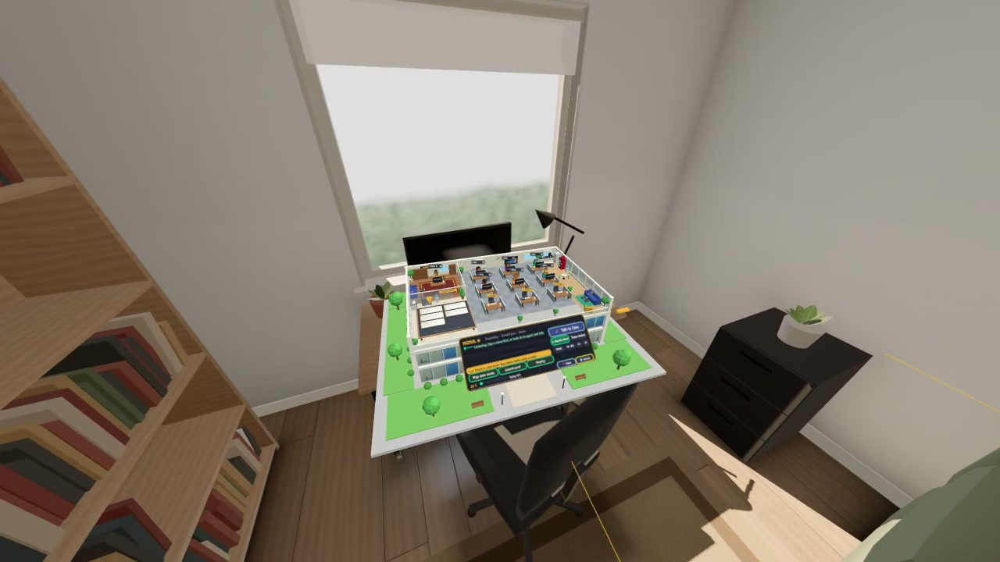
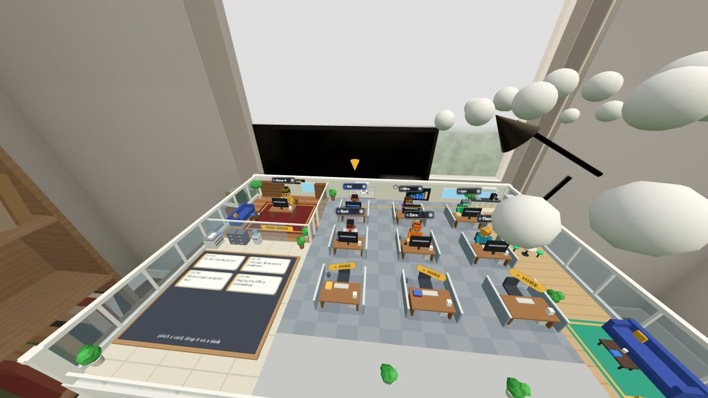
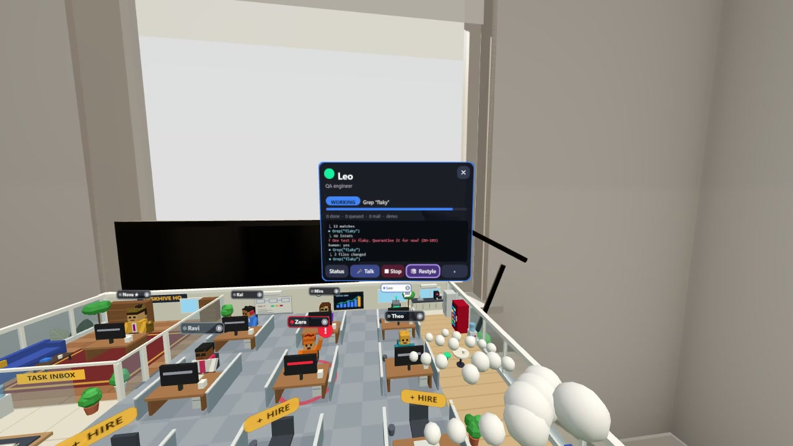
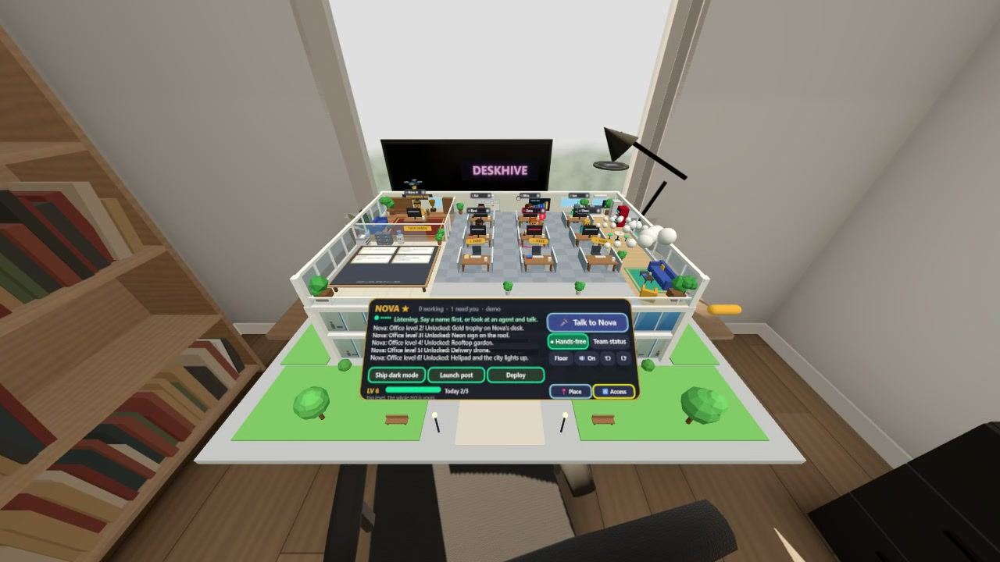
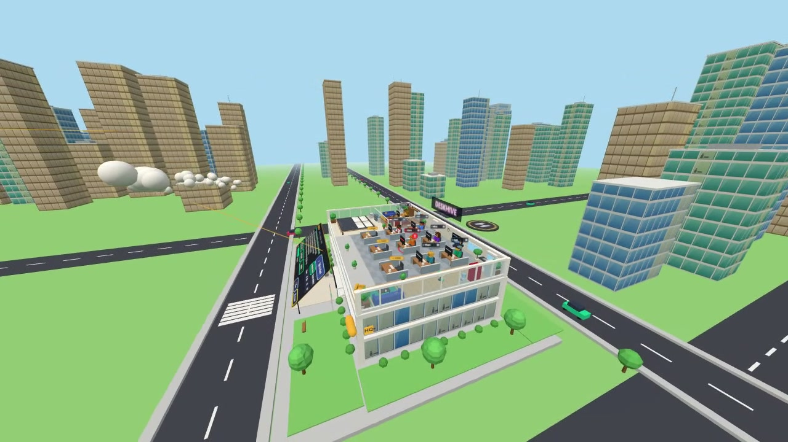
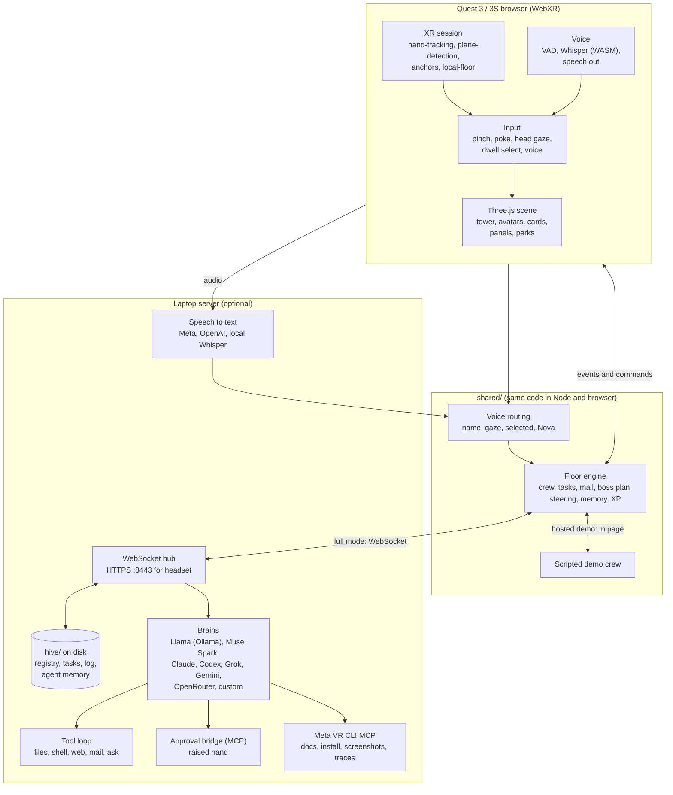

# DeskHive

**An office building full of AI agents on your desk. Look in from above, see them work, and just talk to them.**

Built for the Meta VR Start Developer Competition 2026 (Productivity track, Best Agentic Interaction). Runs on Meta's own stack: WebXR on Quest, **free Llama on your laptop** as the default agent brain, and Meta Muse Spark plus Muse Voice Transcribe when you have a Meta key. The whole thing can run at zero cost.
Inspired by the open source [Munder Difflin](https://github.com/HarnessMD/munder-difflin) agent harness. DeskHive is a clean rebuild with its own crew, its own code, and a new core idea: **the office is a seated, hands-first diorama in VR.**

## The core idea

Terminals hide what agents are doing. In DeskHive the whole team works on the top floor of a little glass office tower (roof cut away), on your real desk (passthrough) or in a small city (VR).
You read the room at a glance:

| What you see | What it means |
| --- | --- |
| Agent typing fast, screen scrolling | Working |
| Hand on chin, head tilt | Thinking |
| **Hand raised, red ring on the floor, "!" bubble** | **Needs you. Waiting on your yes or no.** |
| Hop and cheer, green check | Done |
| Envelope flying desk to desk | Agents messaging each other |

## Screenshots

Captured in the Meta Immersive Web Emulator with its synthetic room.

| | |
| --- | --- |
| <br>**Passthrough.** The office snaps onto the real desk. | <br>**Look in from above.** Seven agents, one floor. |
| <br>**Raised hand.** Red ring and "!" mean an agent needs your yes. | <br>**Come back loop.** Level ups unlock a neon sign, garden and more. |
| <br>**Full VR.** The office gets its own little city. | |

## Talk to your agents

You talk the way you would in a real office.

| You say | What happens |
| --- | --- |
| "Kai, why is the header broken?" | Kai answers you in his own voice. If you asked for work, he does it first, then tells you. |
| "Tell Leo to run the tests" | Goes straight to Leo. |
| "Ship dark mode then deploy" (no name) | Nova, the chief of staff, splits it and routes it to the team. |
| "How is everyone doing?" | Nova answers from live team status. No new tasks. |
| "Make it dark themed" while Mira works | Mira hears it mid task and changes course. |
| "Yes" / "No" | Answers the agent with its hand up. |
| "Stop" | Stops the agent you are talking to. |

**Who hears you:** say a name first. With no name, it goes to the agent you selected, or in the headset the one you are **looking at**. Otherwise Nova.

**Agents remember.** Each agent keeps its conversation with you (saved in `hive/agents/<id>/conversation.jsonl`). Claude Code agents resume the same session every time, so they keep their whole context.

**Raised hand for real.** When a Claude Code agent wants to run something risky (`rm -rf`, `git push`, deploys) its permission prompt comes to DeskHive through a small MCP bridge. The agent raises its hand, you say yes or no, and only then does the command run. Autonomy picks what counts as risky.

### Voice

- **Laptop:** hold **Space** or press 🎤 to talk. 👂 turns on hands-free.
- **Headset:** hands-free turns on when you enter. Talk, or look at an agent and talk.
- **Speech to text runs on your laptop**, so it works in any headset browser (Quest has no built in speech recognition):
  - With a Meta key: Meta Muse Voice Transcribe (`muse-voice-transcribe-1.0`).
  - With an OpenAI key: OpenAI transcription.
  - Without a key: **free local Whisper** on your laptop (`npm install` adds it; a small model downloads the first time).
  - Desktop Chrome or Edge without either: the browser's own speech recognition.
  - **Hosted demo on Quest:** free **Whisper running inside the page** (WebAssembly, `whisper-tiny.en`, about 40 MB once). Add `?wasm` to force it anywhere.
- **Agents talk back** in their own voice (pick it in the Studio). OpenAI voices with a key, browser voices otherwise.
- `DESKHIVE_STT=meta|openai|local|off` to force an engine. `DESKHIVE_WHISPER_MODEL` to pick another Whisper model.

## Your real desk (passthrough)

Press **Enter passthrough** on a Quest 3. DeskHive uses WebXR **plane detection** to find your real table and puts the HQ on it. The room changes the experience: the office sits where you actually work.

- **Snaps to your desk** on its own: it looks for a surface about desk height in front of you.
- **📍 Place** (or say "place office"): point at any table and pinch. It follows your hand until you pinch.
- **Fits your desk.** On a small desk the office shrinks (down to half size) so it does not hang over the edge.
- **Stays there.** The spot is saved as a **persistent spatial anchor**, so next time the office is right where you left it.
- No Space Setup? It just floats at desk height in front of you.

## First five minutes

The first time you enter, Nova coaches you in four short spoken steps with a bouncing arrow on the thing to touch. No wall of text:

1. Pinch a glowing card and drop it on a desk.
2. Talk to someone by name (or poke them).
3. Poke **Deploy**. Your ops agent raises a hand before shipping.
4. Poke **✓ Yes** (or say yes).

Say "help" any time to run it again.

## A reason to come back

- **XP and office levels.** Shipped work earns XP. Each level unlocks something you see in the HQ: a gold trophy, a neon sign on the roof, a rooftop garden, a delivery drone that circles the building, a helipad and the city at night.
- **Daily goal:** ship 3 tasks a day. **Streak:** days in a row.
- **While you were away:** come back after a while and Nova tells you what the team shipped and who has a hand up.
- Saved in `hive/progress.json` (browser storage in the hosted demo).

## Accessibility

- **♿ Access** button: high contrast panels (black, white, yellow), bigger agent panels.
- **Look to select:** rest your gaze on a button or an agent for a moment and it presses itself. No hands needed.
- **Voice for every hand action:** "give the next card to Kai", "assign T-3 to Mira", "place office", "rotate left", "show floor", "next agent", "close", "high contrast on", "look to select on", "mute", "help".
- Every agent line is also on screen as text (captions). Every press makes a click sound.

## Hands only

No controller needed at any step.

- **Pinch** an agent to open their panel. **Poke** buttons with a fingertip.
- **Pinch a task card** on the inbox table, carry it, **drop it on a desk** to assign.
- **Raised hand agent?** Say yes or no, or poke **Yes** or **No** on the panel.
- **Talk** and **Hands-free** buttons on the floating console in front of the building.
- Pinch the **gold handle** to move the building. **Floor** hides the tower and city.
- Seated use. Everything fits in a two foot radius.

## Architecture



Full diagrams (spoken request, raised hand, real desk pipeline) are in [docs/ARCHITECTURE.md](docs/ARCHITECTURE.md). The hackathon requirement checklist is in [docs/HACKATHON.md](docs/HACKATHON.md).

## Run it (Windows, Mac, Linux)

Needs Node 20.19 or newer.

```
npm install
npm run build
npm start
```

Open http://localhost:8080 on your laptop. It starts in **demo mode** with a scripted crew, so no keys are needed.

### No headset? Use the emulator

Open **http://localhost:8080/?emu** and press **Enter VR**. This is Meta's Immersive Web Emulator with a fake Quest 3 and tracked hands.
Press **Enter passthrough** to try the real desk mode: a synthetic home office (Meta's IWER Synthetic Environment Module) with detected planes, so the HQ snaps onto the desk like on a Quest 3. Try other rooms with `?room=open_office`, `kitchen`, `conference_room`.
Use it to try hand interactions and to record your demo video (the rules accept emulator footage).

### First run

A welcome screen walks you through it: connect a brain (or give the whole team Claude Code in one click), test your mic, and get the headset link. Open it again with the **?** button.

### On a Quest or Meta VR glasses

1. Laptop and headset on the same Wi-Fi.
2. `npm start` prints a line like `Headset: https://192.168.1.20:8443`.
3. Open that URL in the headset browser. Accept the certificate warning once.
4. Press **Enter passthrough** (office on your real desk) or **Enter VR**.

### Hosted demo (judges)

`npm run build:demo` makes a static `dist/` that runs the scripted crew fully in the browser, with in-page Whisper for voice. Nothing to install.

- **Vercel:** import the repo. `vercel.json` sets the build.
- **GitHub Pages:** Settings, Pages, Source: GitHub Actions. `.github/workflows/pages.yml` builds with the right base path.

## Any brain, any agent

Every agent has its own brain. Mix them on one floor: Nova on Claude Code, Kai on Codex, Leo on Grok, Mira on Gemini.

Open **Connections** (top bar) to plug brains in. Keys are saved only on your machine in `deskhive.config.json`. Env vars also work.

| Brain | How to connect |
| --- | --- |
| **Llama, free and local (default)** | Install Ollama from ollama.com, run `ollama pull llama3.2:3b` (or `llama3.1:8b` on 8 GB RAM). Leave it running. DeskHive finds it within 20 seconds and moves every agent on the demo brain to Llama. No key, no bill, works offline. |
| Meta Muse Spark | `MODEL_API_KEY` from dev.meta.ai (paid per use). With a key it takes over as the default and agents move to `muse-spark-1.3`. |
| Demo | built in, no keys |
| Claude Code CLI | `npm i -g @anthropic-ai/claude-code`, sign in once. Uses your Claude plan. |
| Codex CLI | `npm i -g @openai/codex`, sign in once. |
| Claude API | `ANTHROPIC_API_KEY` |
| OpenAI | `OPENAI_API_KEY` |
| Grok (xAI) | `XAI_API_KEY` |
| Gemini | `GEMINI_API_KEY` |
| OpenRouter | `OPENROUTER_API_KEY` (hundreds of models) |
| Custom | any OpenAI compatible base URL + key |

API brains run a real tool loop: list and read files, write files, run commands, fetch web pages, message teammates, ask you, remember. Files stay inside `./workspace`. Autonomy gates risky commands: **cautious** asks before anything that changes things, **balanced** asks before deploys, deletes and pushes, **autonomous** never asks.

## Character Studio

Click **+ Hire** or **Design** on any agent (or a floating **+ HIRE** sign over an empty desk). You design:

- Look: species (human, robot, cat), skin or metal, hair and style, shirt, outfit, accessory, eyes, aura. Live 3D preview you can spin.
- Mind: name, role, instructions, skills. Nova routes work by skills.
- Brain: which provider and model, plus autonomy.

Up to 9 workers plus Nova. In a headset a pinch on **+ HIRE** hires a random specialist and **Restyle** rerolls a look. Do the full design on the laptop. The crew saves to `crew.json` (browser storage in the hosted demo).

### Meta VR CLI for your agents

Install the [Meta VR CLI](https://github.com/meta-quest/agentic-tools) (`metavr`). DeskHive finds it and gives every Claude Code agent its MCP server, so agents can search Meta docs, install builds on your Quest, take headset screenshots and read performance traces. Hire the **Quest XR engineer** template for this job. `DESKHIVE_METAVR=off` turns it off.

Other settings: `DESKHIVE_WORKSPACE` (folder agents work in), `DESKHIVE_CREW` (crew file), `DESKHIVE_CLAUDE_FLAGS`, `DESKHIVE_CODEX_FLAGS`, `DESKHIVE_CLAUDE_BIN`, `DESKHIVE_CODEX_BIN`.

## The hive on disk

Everything the team knows is plain files in `./hive`, so you can read it, grep it and put it in git.

```
hive/PROTOCOL.md       how agents talk (real CLI agents read this)
hive/registry.json     the crew
hive/tasks.json        the task ledger
hive/log.jsonl         append only event feed
hive/agents/<id>/      identity.md, memory.md, inbox/, outbox/
```

Real agents send mail by writing a JSON file into their `outbox/`. The router delivers it and the envelope flies in VR.
Agents ask the human by ending a message with `ASK_HUMAN: <question>`. That is the raised hand.
Loops are cut off at a hop cap and Nova steps in.

## Layout

```
shared/     floor engine: crew, tasks, mail, boss planning, conversations, voice routing (Node and browser)
server/     WebSocket hub, hive on disk, brains, approval bridge for Claude Code, speech (STT and TTS), HTTPS
web/        Three.js WebXR app: office tower, voxel agents, cards, panels, hands, voice, Studio, welcome
test/       engine, brain and voice tests (npm test)
```

## Meta VR Start checklist

- Hands first: yes. Every action works with hands only, end to end, including onboarding and menus. Controllers also work.
- Seated: yes. Tabletop diorama on your real desk, nothing needs walking. Passes the airplane seat test.
- Quick to enter: loads in seconds, the coach gives a full loop in under 5 minutes. Pauses cleanly when you open the system menu.
- Original, not a wrapper: take away every AI service and the office, the crew, the floor engine and the demo brain still run.
- Platform features: hand tracking (pinch, poke, ray), head gaze targeting, passthrough with plane detection, persistent spatial anchors, fixed foveated rendering, IWER emulator with a synthetic room.
- Performance: shadows off in the headset, foveation on, panels redraw at most 6 times a second. A frame guard hides the city and slows redraws if the frame rate drops. Add `?perf` to see a live fps readout.

## Credits

Idea inspired by Munder Difflin by HarnessMD (MIT). No code or art from that project is used here.
Built with Three.js and Meta's Immersive Web Emulator (iwer).
