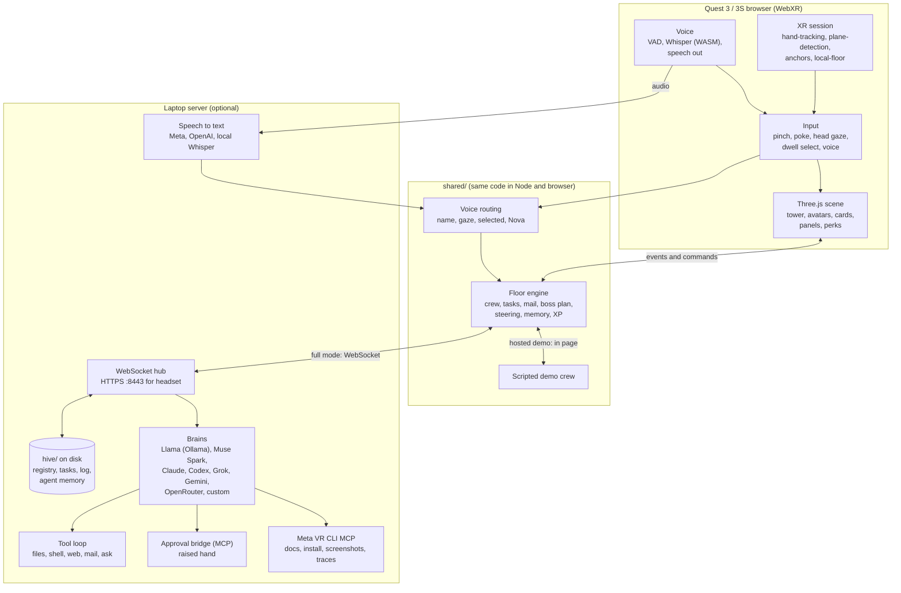
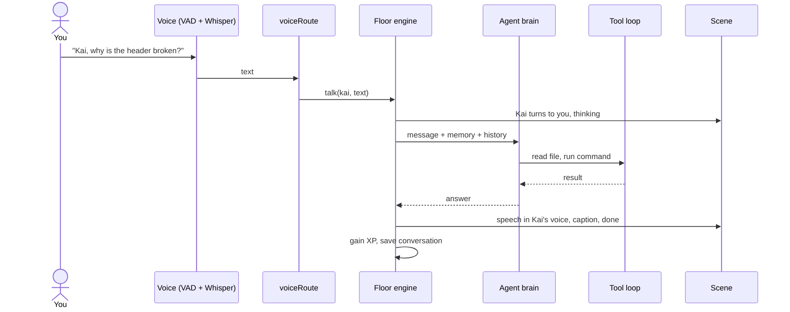
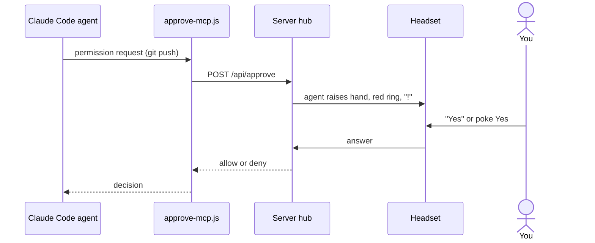
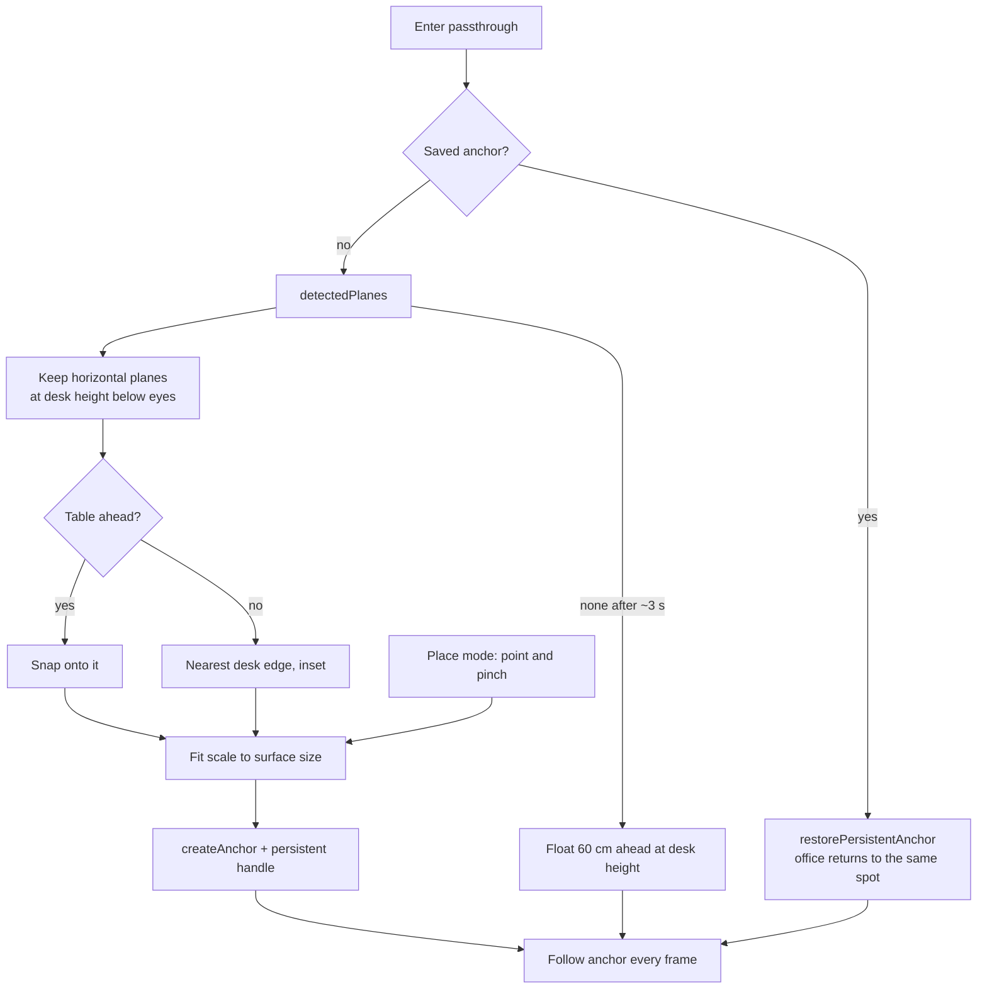

# DeskHive architecture

DeskHive has three layers. The headset app draws the office and takes hands and voice. The floor engine decides what the crew does. Brains and tools do the real work.

## 1. System overview

Hosted demo mode runs the floor engine and the scripted crew inside the page. Nothing to install. Full mode adds the laptop server with real brains.

## 2. One spoken request, end to end

Say a name and the request goes to that agent. With no name it goes to the agent you look at, then the selected one, then Nova.

## 3. Raised hand (approval bridge)

Autonomy sets what counts as risky: cautious, balanced, autonomous.

## 4. Real desk pipeline (passthrough)

Every step has a fallback, so it works in a room we never tested.

## 5. Performance guards

- Fixed foveated rendering at max.
- Shadows off in the headset.
- Panels redraw at most 6 times a second (2.5 when slow).
- Frame guard: if frames stay under 85% of the display rate for 3 seconds, the city is hidden and panel redraws slow down.
- `?perf` shows a live fps readout.
- Pause on system menu: hands-free listening and speech stop, then resume.

## Folder map

| Folder | Job |
| --- | --- |
| `web/src/main.js` | XR session, input, planes, anchors, loop |
| `web/src/scene/` | tower, avatars, cards, panels, perks |
| `web/src/voice.js` | VAD, in-page Whisper, speech out |
| `shared/` | floor engine, protocol, voice routing, scripted crew |
| `server/` | hub, hive on disk, brains, approval bridge, speech, HTTPS |
| `test/` | engine, brain and voice tests |
